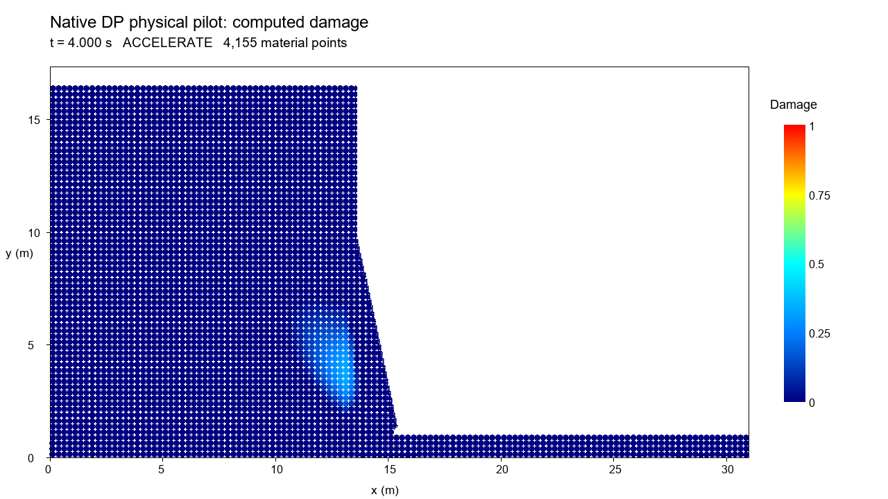
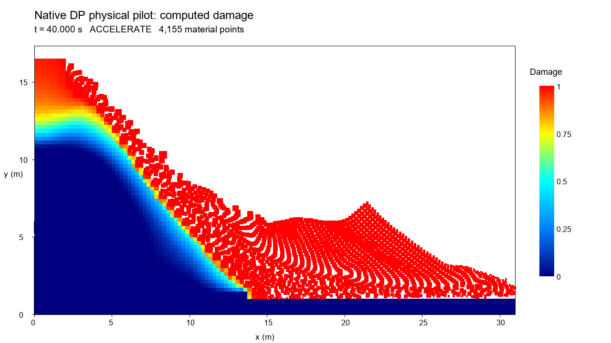
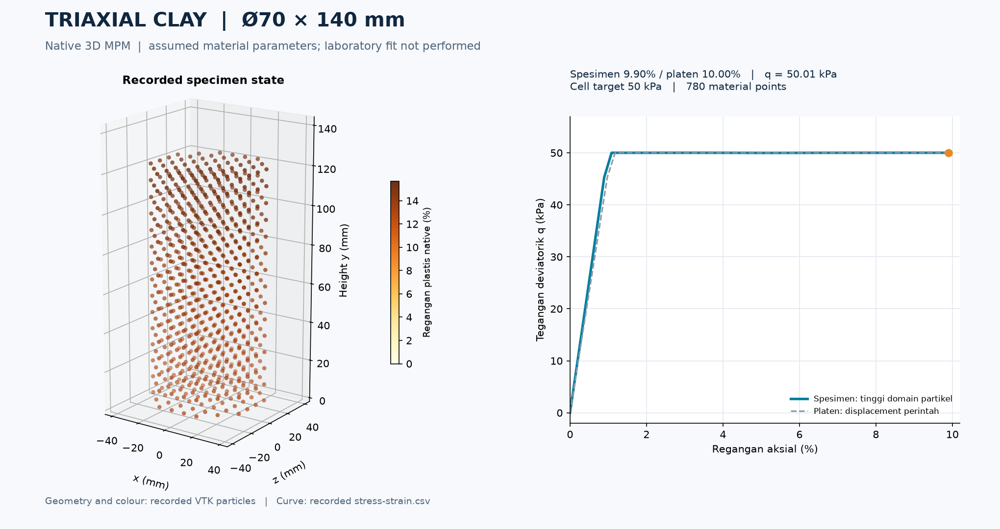

# Laporan Pengembangan CL-MPM Studio dari Repositori Asli

**Tanggal audit:** 15 Oktober 2026  
**Repositori asal:** [samjvsutcliffe/cl-mpm](https://github.com/samjvsutcliffe/cl-mpm)  
**Repositori pengembangan:** [hadrianJavas12/MPM](https://github.com/hadrianJavas12/MPM)  
**Cakupan utama:** diff sampai commit `f7fb2a3`. Bagian 9 mencatat modul kalibrasi baru sesudah snapshot tersebut; modul ini tidak termasuk hitungan 273 berkas baru/5 berubah di bagian utama.

## 1. Ringkasan hasil pengembangan

Pengembangan mempertahankan mesin Material Point Method (MPM) Common Lisp milik
upstream dan menambahkan alur kerja Windows serta pengendali simulasi berbasis
browser bernama **CL-MPM Studio**. Kontribusi utama adalah instalasi dan launcher
native Windows, konfigurasi geometri/material yang konsisten, penyuntingan serta
ekspor model Lisp, pengamanan operasional eksekusi kode kustom, dan pencatatan
keluaran beserta bukti pengujian. Kemampuan MPM, hukum konstitutif dasar, damage
nonlocal, stabilisasi agregasi, serta contoh Joss telah tersedia di upstream.

Perbandingan Git mencatat **273 berkas baru dan 5 berkas lama berubah**. Sebanyak
**308 dari 313 berkas upstream tetap identik** pada path yang sama. Di direktori
`src/`, **79 dari 80 berkas lama identik**; satu perubahan adalah penulis VTK,
ditambah satu shim MPI serial. Seluruh berkas lama dalam `src/core/`,
`src/models/`, `src/damage/` dan `src/dynamic-relaxation/` tetap identik. Bukti
identitas memakai objek blob Git, bukan kesimpulan dari nama berkas.
[Data perbandingan](evidence/upstream-comparison-2026-10-15/comparison.json).

Pada kasus yang direkam, Windows native, integrasi browser dan ekspor Lisp
berjalan. Pilot runtuhan 40 s telah diterima pengguna secara visual; audit
mendukung asal gambar/video dari data solver. **Hasil ini belum tervalidasi
ilmiah.** Laporan membedakan fitur yang tersedia, pengujian yang benar-benar
tercatat, dan pertanyaan numerik yang masih terbuka.

## 2. Dasar perbandingan dan ketertelusuran

| Objek | Baseline yang digunakan |
| --- | --- |
| Upstream | `d8e65543c55634b54b9d8edf2a6bcf6082415bdc` |
| Tanggal commit upstream | 16 Juni 2026, 21:59:29 +01:00 |
| Fork yang dibandingkan | `f7fb2a3322eabf483b3d6cedd2c090b356ca01ca` |
| Tanggal commit fork | 15 Oktober 2026, 10:05:43 +07:00 |
| Merge base | Sama persis dengan commit upstream di atas |
| Ancestry | 0 commit khusus upstream; 58 commit khusus fork |
| Metode | Diff dua tree Git tetap; tanpa perubahan working tree |

Baseline upstream diambil dari `main` repositori asli ke ref lokal
`refs/remotes/upstream-audit/main`. Karena merge base sama dengan SHA upstream,
perbandingan ini merupakan pengembangan terhadap ancestor yang nyata. Tautan
commit tetap: [upstream d8e65543](https://github.com/samjvsutcliffe/cl-mpm/commit/d8e65543c55634b54b9d8edf2a6bcf6082415bdc)
dan [fork f7fb2a3](https://github.com/hadrianJavas12/MPM/commit/f7fb2a3322eabf483b3d6cedd2c090b356ca01ca).

Snapshot API GitHub pada 15 Oktober 2026, 03:22:45 UTC, mencatat PR
[#1](https://github.com/hadrianJavas12/MPM/pull/1),
[#2](https://github.com/hadrianJavas12/MPM/pull/2),
[#3](https://github.com/hadrianJavas12/MPM/pull/3) dan
[#4](https://github.com/hadrianJavas12/MPM/pull/4) tetap terbuka sebagai draft
berantai. Draft [PR #6](https://github.com/hadrianJavas12/MPM/pull/6) untuk
modular Lisp/preset berada pada branch terpisah dan **tidak termasuk implementasi
baseline ini**. [Snapshot status langsung](evidence/upstream-comparison-2026-10-15/source-live-github-status.json).

Hitungan tidak memasukkan toolchain unduhan, seluruh keluaran lokal yang
diabaikan Git, preferensi Obsidian lokal, atau pekerjaan sesudah `f7fb2a3`.
Penyusunan laporan hanya membaca Git, kode dan bukti tersimpan; tidak menjalankan
ulang Node, SBCL maupun simulasi. Status pengujian di bagian 6 adalah hasil
eksekusi historis yang log atau ringkasannya tersedia.

## 3. Kemampuan upstream dan kontribusi fork

| Aspek | Sudah tersedia di upstream | Pengembangan pada fork |
| --- | --- | --- |
| Mesin numerik | MPM SBCL, GIMP, finite strain, explicit dynamics, adaptive timestep, threading | Tetap digunakan oleh Studio melalui adapter Lisp |
| Material dan damage | CLOS, elastis/plastis VM–MC–DP, chalk delayed damage dan nonlocal damage | Parameter material pada UI/schema; kelas khusus untuk model kustom dan referensi |
| Solver dan stabilisasi | Quasi-static/dynamic relaxation, ghost stabilization dan aggregation | Pengendali fase referensi, statistik dan metadata di lapisan Studio |
| Skenario riset | Contoh chalk dan Joss, pengaturan geometri melalui kode Lisp | Geometri tebing/takik terparameterisasi, preset referensi dan pemeriksaan geometri |
| Sistem operasi | README menyebut Ubuntu/WSL teruji dan kendala MAGICL di Windows | Setup, dependency lokal, DLL dan launcher native Windows |
| Keluaran | VTK, plot GNUplot dan CSV | Perbaikan penulis VTK Windows, pemeriksaan PNG, browser, video dan audit artefak |
| Ekstensibilitas | Penulis dapat menambah kelas/metode CLOS | Editor/import sumber, template, ekspor `simulation.lisp` dan kontrak kelas Studio |

Kolom upstream merangkum [README pada commit asli](https://github.com/samjvsutcliffe/cl-mpm/blob/d8e65543c55634b54b9d8edf2a6bcf6082415bdc/README.md)
dan sumber yang dipertahankan. Ini atribusi kemampuan kode, bukan pernyataan
bahwa seluruh model/platform upstream diuji ulang dalam pengembangan ini.
Salinan README asli tersedia dalam
[bundle perbandingan](evidence/upstream-comparison-2026-10-15/upstream-README.md).

### 3.1 Windows native dan dependency

`windows/setup.ps1`, `env.cmd`, `init.lisp` dan `cl-mpm.cmd` menyiapkan serta
meluncurkan SBCL dengan Quicklisp dan pustaka lokal. `build-kirchoff.cmd`
menyediakan jalur pembangunan DLL; `make-video.cmd` menghubungkan frame dengan
ffmpeg. Bootstrap Quicklisp memakai berkas Lisp sementara dan menonaktifkan
init pengguna/sistem untuk menghindari masalah quoting PowerShell dan urutan
muat. Pengujian instalasi baru pada path berspasi telah dicatat.

Dependency `deps/` memuat sumber MAGICL/vgplot dan stand-in `swank.live`.
Kode lokal mencakup pencarian OpenBLAS Windows, binding eigen simetris
`%DSYEV`/`%SSYEV`, penyesuaian CFFI dan path plotting. Karena seluruh direktori
dependency baru terhadap tree upstream, hitungan tambahannya mencakup salinan
kode pihak lain. **Laporan tidak mengatribusikan seluruh isi vendored sebagai
kode baru penulis fork.** Pembandingan khusus terhadap commit asal masing-masing
dependency tidak dilakukan. [Rincian teknis](development.md).

### 3.2 Studio, geometri dan parameter material

Browser mengirim JSON ke server Node; server memvalidasi konfigurasi dan
meluncurkan SBCL. Perhitungan posisi, tegangan dan damage berlangsung dalam
mesin CL-MPM. `studio/schema.json` menjadi spesifikasi parameter; normalisasi
API dan ekspor berbagi `public/config.js`, lalu dibaca oleh konfigurasi Lisp.

Geometri menyediakan tinggi/aspek tebing, kemiringan/overhang dan takik
persegi, elips atau segitiga dengan posisi ujung yang dapat diatur. Adapter
`scenario.lisp` benar-benar memotong material points. Preview SVG hanya
representasi geometri tersampel; resolusinya dapat berbeda dari diskretisasi
partikel dan bukan hasil simulasi. [Kontrak geometri](../studio/GEOMETRY.md).

Kontrol material mengekspos E, ν, kohesi, sudut friksi/dilatasi, flag plastisitas
dan damage, ambang/delay damage, ductility serta panjang nonlocal. Konversi
GPa/kPa ke Pa dan derajat ke radian dinyatakan eksplisit. Model biasa tetap
berbasis `particle-chalk-delayed`; kontrol ini tidak menciptakan hukum material
baru. [Pemetaan parameter dan satuan](../studio/MATERIAL.md).

### 3.3 Model Lisp kustom, ekspor dan batas keamanan

Studio menambah editor teks, import `.lisp`, template delegate/elastic,
pemeriksaan leksikal, serta unduhan sumber dan skrip simulasi. Model berjalan
pada subclass `studio-custom-chalk`; loader menghapus metode utama lama,
menolak kontrak yang hilang dan memeriksa matriks tegangan Kirchhoff 6×1
double-float finite. Pemeriksaan ini memverifikasi antarmuka; pemeriksaan tanda
kurung browser tidak memverifikasi semantik, keamanan atau hukum fisik.

Eksekusi kode kustom dinonaktifkan secara default. Server mensyaratkan opt-in
lokal, loopback, JSON/origin/Host yang sesuai, konfirmasi per run dan batas
sumber 32 KiB. Common Lisp tetap memiliki kewenangan akun OS: **tidak ada
sandbox**. Model tegangan kustom juga tidak otomatis mengganti API evolusi
damage. Skrip ekspor memerlukan instalasi CL-MPM dan dependency yang sesuai.
[Kontrak dan pengamanan](../studio/CUSTOM_MODELS.md).

### 3.4 Jalur eksperimen referensi Joss

`studio/lisp/reference-joss.lisp` menambah kelas referensi khusus, geometri
Joss terparameterisasi, persiapan equilibrium, fase accelerate/collapse,
stabilisasi agregat dan statistik pada degree of freedom agregat. Driving
damage memakai kriteria Drucker–Prager dari contoh penulis dengan friksi dalam
radian; dasar index-1 dilindungi secara elastis. Ini adapter terhadap mekanisme
yang telah ada, dengan asumsi dan parameter yang dicatat.

`examples/chalk/joss.lisp` asli tetap **identik** pada kedua commit. Adaptasi
baru tidak sama dengan menjalankan contoh asli tanpa perubahan, dan bukan
bukti implementasi literal semua persamaan paper.
[Spesifikasi eksperimen](REFERENCE_REPRODUCTION.md).

## 4. Ukuran perubahan dan kode yang dipertahankan

| Kelompok perubahan | Baru | Berubah | Baris + / − |
| --- | ---: | ---: | ---: |
| Dependency vendored | 117 | 0 | 139.199 / 0 |
| Studio: UI, schema, adapter, dokumentasi dan tes | 36 | 0 | 5.797 / 0 |
| Runtime/launcher Windows dan DLL | 7 | 0 | 369 / 0 |
| ASDF, output engine dan shim MPI | 1 | 2 | 145 / 16 |
| Kompatibilitas contoh chalk | 0 | 1 | 6 / 3 |
| Skrip verifikasi/rendering | 9 | 0 | 1.066 / 0 |
| Bukti eksperimen tersimpan | 60 | 0 | 32.648 / 0 |
| Dokumentasi proyek termasuk README | 15 | 1 | 2.181 / 2 |
| Wiki pengetahuan | 20 | 0 | 1.009 / 0 |
| Aturan repositori/agen dan CI | 8 | 1 | 964 / 0 |
| **Total** | **273** | **5** | **183.384 / 21** |

Tidak ada berkas upstream dihapus. Sebanyak 11 perubahan adalah berkas biner;
baris pada tabel hanya menghitung teks. Sekitar 93,7% tambahan baris berada pada
salinan dependency dan arsip bukti. Jumlah ini menjelaskan komposisi repositori,
bukan ukuran inovasi algoritmik atau akurasi. Aturan kategori yang tidak
tumpang tindih dan hitungan setiap path tersedia dalam
[changed-files.json](evidence/upstream-comparison-2026-10-15/changed-files.json).

Hanya lima berkas lama berubah: `.gitignore`, `README.md`, `cl-mpm.asd`,
`examples/chalk/chalk.lisp`, dan `src/output.lisp`. Tiga yang berkaitan dengan
sumber mempunyai perubahan terbatas berikut.

| Berkas lama | Perubahan hunk yang diperiksa | Implikasi |
| --- | --- | --- |
| `cl-mpm.asd` | Feature/guard MPI serial, melewati expokit di Windows, dependency model chalk eksplisit | Pemilihan sistem/platform; tidak menulis ulang algoritme P2G/G2P |
| `examples/chalk/chalk.lisp` | Menonaktifkan initargs `:ft`, `:fc`, `:fracture-energy` yang tidak diterima kelas | Memperbaiki konstruksi contoh; tidak mengganti metode konstitutif |
| `src/output.lisp` | Header ASCII dan payload biner VTK memakai satu stream octet | Memperbaiki korupsi dua append handle Windows; field numerik tidak dihitung ulang |

Tambahan `src/mpi/serial.lisp` menyediakan kelas/simbol untuk proses tunggal:
reduksi serial dan predicate domain lokal tersedia, sedangkan komunikasi
antarproses memicu `mpi-unavailable`. Ini **bukan implementasi MPI terdistribusi
Windows**. Sumber hunk lengkap disimpan sebagai
[modified-original-source.patch](evidence/upstream-comparison-2026-10-15/modified-original-source.patch).

| Kelompok sumber lama | Identik / jumlah upstream |
| --- | ---: |
| Seluruh `src/` | 79 / 80 |
| `src/core/` | 12 / 12 |
| `src/models/` | 9 / 9 |
| `src/damage/` | 11 / 11 |
| `src/dynamic-relaxation/` | 10 / 10 |
| Seluruh `examples/` | 71 / 72 |
| Seluruh `libs/` | 24 / 24 |

Baris subdirektori adalah rincian yang saling tercakup, sehingga tidak boleh
dijumlahkan. Identitas sumber membuktikan pelestarian implementasi pada Git;
pilihan kelas, konfigurasi, binding dan dependency tetap dapat mengubah
perilaku run tertentu. Tidak diklaim seluruh keluaran upstream identik.

## 5. Hasil visual dan asal data



**Gambar 1.** Damage awal yang tersimpan pada pilot: t=4 s, maksimum sekitar
0,333589 pada bagian bawah muka tebing. Warna menyatakan damage 0–1 dari VTK.
Ini keluaran solver, berbeda dari preview geometri.



**Gambar 2.** Bentuk akhir pilot 40 s yang diterima pengguna secara visual.
Lihat [video yang dipertahankan](evidence/joss-collapse-2026-10-15/accepted-collapse.mp4).
Kasus ini memiliki 4.155 partikel, 174 frame fisik dan massa tetap
425.664,0625 kg/m. Sebanyak 496 partikel dasar dilindungi dari plastisitas/damage.

Pilot menggunakan keadaan equilibrium tersimpan dari probe 1.658 update dan
subclass historis `joss-probe-dp-chalk`. Konfigurasi `settleMaxSteps=1` pada arsip
adalah konfigurasi warm start, bukan input fresh start. Produksi sekarang
memiliki kelas referensi tersendiri. Replay produksi baru sampai 4 s selesai
tanpa replacement constructor/kelas/environment historis: equilibrium 1.658
update, beda posisi terhadap pilot sekitar 9,30×10⁻¹⁰ m dan beda damage
1,18×10⁻⁷. Ini mendukung reproduksi inisiasi, bukan replay penuh 40 s.

Perbandingan citra akhir pilot t=40 s dengan referensi t=221,14 s memberikan
IoU sekitar **0,699825**, run-out lebih jauh **7,8 m**, serta retreat plateau
lebih besar **5,2 m**. IoU tersebut bukan persentase akurasi fisik dan kedua
waktu tidak sama. Kandidat berikutnya dengan ambang 40 kPa selesai pada
221,14 s/111 frame tetapi **tidak runtuh**, damage maksimum 0,49062952.
Kedua kasus dipisahkan dalam [indeks bukti runtuhan](evidence/joss-collapse-2026-10-15/README.md).

## 6. Verifikasi yang telah tercatat

| Tanggal dan jenis bukti | Hasil yang tercatat | Batas interpretasi |
| --- | --- | --- |
| 14 Okt: syntax dan kontrak Node/SBCL | `npm run check` lulus; 33 tes lulus, nol skip | Kontrak SBCL memakai dependency stub; bukan seluruh solver |
| 14 Okt: launcher Windows/engine | Smoke elastis 100 MP/50 update; delegate 64 MP/2 update/80 panggilan; beda posisi/tegangan nol | Kasus pendek; delegate mematikan plastisitas/damage |
| 14 Okt: integritas output | Dua VTK delegate berisi 36 scalar finite; parser menolak 7 korupsi; PNG jalur sukses/gagal diperiksa | Parser khusus layout partikel repositori |
| 14 Okt: browser dan ekspor | Run 3 frame selesai; 28 parameter dan byte sumber sama; mesh + 3 VTK + 3 PNG identik byte/hash | Satu kasus delegate tepercaya, bukan semua model/preset |
| 15 Okt: validasi integrasi referensi | Check lulus; 36/36 tes, nol skip, termasuk 3 kontrak SBCL nyata | Tidak membuktikan kalibrasi material |
| 15 Okt: smoke referensi native | 179 update persiapan; 4 VTK finite; 2 PNG; 124 MP dasar dilindungi; guard equilibrium gagal bekerja | Berhenti karena batas frame; 0,02 s, belum mencapai target 0,03 s |
| 15 Okt: audit pilot dan visual | Semua 174 VTK finite; 174 PNG regenerasi identik; video cocok dalam galat H264 | Integritas dan asal visual; bukan validasi ilmiah |
| 15 Okt: fresh replay produksi | Exit 0 sampai 4 s; inisiasi bawah dekat dengan pilot historis | Dua frame, bukan replay runtuhan penuh |

Sumber hasil Windows: [laporan eksekusi](windows-verification-2026-10-14.md),
[paritas konfigurasi](evidence/upstream-comparison-2026-10-15/source-config-parity.json)
dan [paritas output](evidence/upstream-comparison-2026-10-15/source-output-parity.json).
Sumber hasil referensi:
[ringkasan validasi](evidence/joss-collapse-2026-10-15/validation/validation-summary.json),
[audit ilmiah](SCIENTIFIC_AUDIT_2026-10-15.md), serta
[bundle audit](evidence/scientific-audit-2026-10-15/README.md).

Toolchain Windows yang direkam pada 14 Oktober mencakup SBCL 2.6.9,
Node 24.13.0, OpenBLAS 0.3.34, gnuplot 6.0 pl1 dan ffmpeg 9.0.1. Hosted
Actions terakhir yang didiagnosis tidak memulai job karena billing lock akun.
Ini diagnosis bertanggal dari anotasi check, bukan bukti CI hijau atau
pemeriksaan ulang billing pada saat laporan disusun.

## 7. Batas ilmiah dan pekerjaan yang belum tersedia

Audit native menemukan tiga batas metode yang perlu ditindaklanjuti. Kernel
nonlocal memakai radius nominal pada sisi pengumpul dan radius rusak pada
tetangga; kontrol pasangan menunjukkan asimetri. Bentuk polinomial kernel juga
berbeda dari Eq.(33) paper. Fallback agregasi dapat memilih support melintasi
celah kosong 8 m pada kontrol sintetis. Kontrol F-bar mengukur perbedaan antara
volume dan determinant gradient/domain; ini membutuhkan kontrak kinematika
teruji dan tidak otomatis merupakan kesalahan.

`src/damage/damage.lisp`, `src/aggregate.lisp` dan sumber update F-bar identik
dengan upstream. Temuan tersebut **diwarisi dari implementasi yang digunakan**;
fork menambah kontrol/audit yang mengungkapkannya, belum memperbaikinya pada
baseline ini. Dampak maupun frekuensinya pada pilot penuh belum diukur.
[Hasil kontrol dan keterbatasan](evidence/scientific-audit-2026-10-15/NATIVE_CONTROLS.md).

Mass scaling 10.000 pada fase accelerate, damping, dasar elastis, pemilihan DP,
warm start dan reset kecepatan adalah bagian asumsi/prosedur run. Waktu yang
ditampilkan adalah waktu integrasi dengan jadwal tersebut. Pilot E=1 GPa dan
Gf=4,8 J/m² juga tidak sama dengan seluruh input tabel paper. Masih diperlukan
neraca energi lengkap, sensitivitas mesh/timestep/MP/fase, pemeriksaan agregasi
fragmen aktual, dan pembandingan material/eksperimen sebelum klaim prediksi.

Fitur yang belum tersedia pada baseline meliputi pengelola import/export
modul `.lisp` selektif dan preset lengkap, geometri polygon bebas, pengelolaan
riwayat run terisolasi, serta validasi umum model kustom. Import sumber
konstitutif dan ekspor skrip yang sudah ada tidak boleh dilabeli sebagai
implementasi lengkap rencana [modular Lisp I/O](MODULAR_LISP_IO.md).

## 8. Paket bukti dan cara memeriksa ulang

Bundle [upstream-comparison-2026-10-15](evidence/upstream-comparison-2026-10-15/README.md)
berisi provenance SHA, daftar seluruh path, statistik teks/biner, hunk sumber
lama, bukti identitas blob dan salinan ringkasan hasil. `manifest.json` menyimpan
ukuran dan SHA-256 setiap berkas bundle. Raw source eksperimen terdahulu tetap
dipertahankan di bundle aslinya.

Audit diff dapat diregenerasi tanpa simulasi:

```powershell
python docs/evidence/upstream-comparison-2026-10-15/build-comparison.py
git diff --name-status d8e65543c55634b54b9d8edf2a6bcf6082415bdc f7fb2a3322eabf483b3d6cedd2c090b356ca01ca
```

Untuk eksekusi pengujian yang baru, ikuti [panduan pengujian](testing.md) dan
[panduan Windows](windows-setup.md). Setiap perubahan fisika berikutnya perlu
menyimpan konfigurasi efektif, source/commit, log, VTK dan pemeriksaan referensi
yang sesuai. Laporan ini memberikan dasar audit perubahan dan cakupan bukti
yang telah tersedia sampai baseline yang dinyatakan.

## 9. Pengembangan lanjutan: demonstrasi kalibrasi triaxial clay

Setelah snapshot f7fb2a3, branch `codex/triaxial-clay-calibration` menambahkan
kasus terpisah untuk spesimen nominal diameter 70 mm dan tinggi 140 mm. Ini bukan
perubahan solver chalk/Joss dan tidak termasuk hitungan diff utama laporan.
Model memakai VM elastoplastik native sebagai pendekatan undrained total stress,
parameter asumsi E = 5 MPa, nu = 0,49, skala su = 25 kPa dan tekanan sel = 50 kPa. Belum ada
data laboratorium maupun model air pori; tidak ada klaim kalibrasi eksperimen.

| Tambahan | Fungsi dan bukti |
| --- | --- |
| `calibration/triaxial.lisp` dan config | Run MPM 3D serta pembanding konstitutif homogen, tanpa seed damage, F-bar, agregasi atau mass scaling |
| `scripts/run-triaxial.lisp` | Launcher native dengan snapshot harness untuk run berikutnya |
| `scripts/plot-triaxial.py` | Partikel terekam dan kurva q-regangan berdampingan, PNG/video dari VTK/CSV |
| `scripts/audit-triaxial.py` | Audit massa, tegangan, volume, displacement, yield dan diagnostik energi |
| `calibration/estimate-clay-parameters.py` | Inisialisasi E/su/rho dari CSV; pilihan kolom regangan dan provenance; 4 unit test lulus |



Run MPM 3D menyelesaikan 17.443 update / 51 frame, dengan 780 MP sampai regangan platen 10%.
Regangan spesimen dari tinggi domain partikel 9,89852%, q akhir 50,00844 kPa dan
tekanan lateral 50,02246 kPa. Volume drift maksimum 0,020016%; massa tetap.
Pembanding homogen menjalankan 1.000 increment dengan q akhir 50,01000 kPa.

Kontrol native memeriksa tangent elastis, yield VM, kontrol tegangan lateral
serta equilibrium hidrostatik 3D; semua lulus pada cakupan terbatas tersebut.
Pemeriksaan Node terbaru 36/36 lulus tanpa skip. Uji ini tidak menggantikan data
laboratorium atau studi konvergensi. Bias volume diskret kasar MPM +3,4507%,
compliance spring ujung bilateral, transien energi kinetik awal dan batas
provenance sumber produksi dinyatakan pada metode dan bundle bukti.

Baca [metode kalibrasi](TRIAXIAL_CALIBRATION.md),
[cara menjalankan](../calibration/README.md) dan
[bukti native triaxial](evidence/triaxial-clay-2026-10-15/README.md).