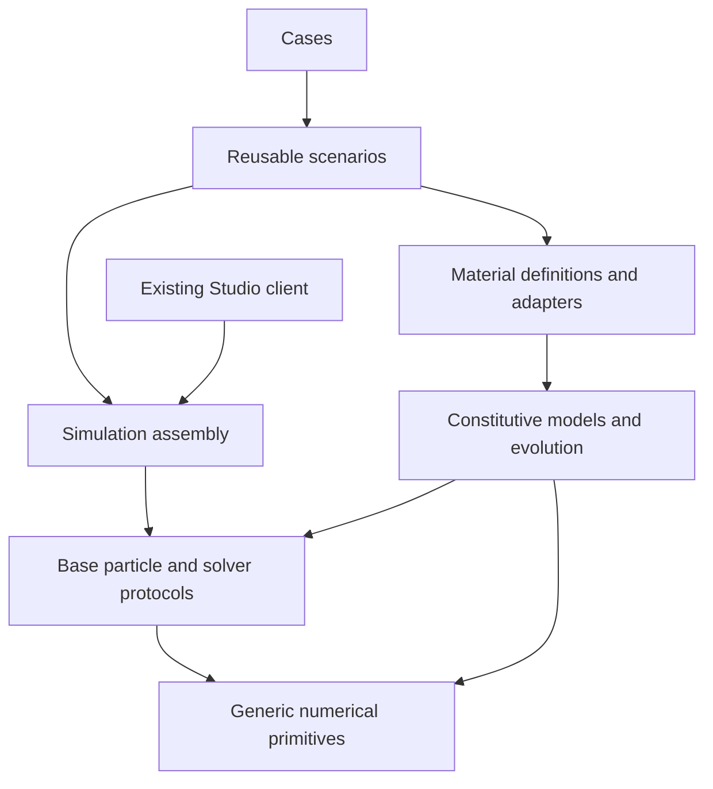

# Dependency and compatibility contracts

These rules implement the [migration specification](CL_MPM_ARCHITECTURE_MIGRATION_SPEC_AGENT.md)
across the installed Section 2 repository layout (`cl-mpm.asd`, `cl-mpm-framework.asd`,
and `materials/cl-mpm-materials.asd`).

## Allowed dependencies

- Engine base particle/generic constitutive methods precede model specializations.
  Solvers call those generics; material-specific equations remain in materials.
- Model implementations use base state and numerical primitives, without importing
  scenario construction, Studio, research reports or output rendering.
- Scenario modules assemble models, geometry, boundaries, loading and measurements.
  Case files select these components without global solver/material method patches.
- Generic output accepts declared model fields. Field ownership and units are
  explicit, without rewriting global writers to assume one plastic model.
- Legacy ASDF and CLOS names forward to canonical physical owners. Compatibility
  entrypoints load one implementation; they must not define a second class/method.

## Existing load graph and hazards

`cl-mpm/particle` depends on constitutive, native extension and mesh systems, then
loads `src/core/particle-base.lisp`, plastic (`materials/core/plastic-state.lisp` +
`materials/models/...`) and concrete (`materials/models/concrete/legacy.lisp`) in
that order. `cl-mpm/damage` depends on particle and loads its generic nonlocal
transport (`src/damage/`) and damage material modules (`materials/models/damage/`
and `materials/models/frictional-damage/`) later. Concrete's damage superclass is
forward-referenced at the earlier load stage. Preserve that observable order; a
particle/damage cycle is forbidden.

`cl-mpm-framework` loads configuration/package/component definitions (`src/simulation/`)
before material factories and diagnostics (`materials/core/`, `materials/adapters/`,
`materials/diagnostics/`), then scenario modules (`scenarios/cliff/`, `scenarios/joss/`,
`scenarios/triaxial/`). Some material adapters use the framework component classes;
a `materials -> full framework -> materials` cycle is forbidden.

`cl-mpm-studio` depends on the headless framework. The reverse dependency on the
Studio ASDF system is forbidden. The current legacy schema file is an input
compatibility contract; its presence does not permit a UI runtime dependency.

The actual system/component graph is recorded by the inventory audit, with its
platform and static/dynamic evidence scope. Optional/commented models remain
optional: migration must not silently activate them in the default load graph.

## Required preservation

| Contract | Verification |
| --- | --- |
| ASDF names/dependencies/load order | Actual native load/introspection before and after; no cycles |
| Class/package/generic identity | Class precedence, slots, method specializers, construction and direct native calls |
| Backend and ABI | DLL hashes/selection and fallback scope; no native rebuild for a path change |
| CLI and standalone `load` | Native Windows old/new entry points, output collision and failure handling |
| Run provenance | Snapshot every relocated executed material/evolution/backend source; never label live source frozen |
| Numerical output | Existing fixed strict comparator; VM 2D/3D, serial Joss and bounded MC/cliff |
| Parallel behavior | Preserve the four-worker strict failure as an open exception |
| Unavailable controls | Explicit rejection; no VM history rollback for unsupported models |

Source bytes and top-level form hashes complement execution; they do not
substitute for a numerical test of a changed load path. A failed or unexecuted
gate stays FAIL/BLOCKED/NOT_RUN with its real log and recovery action.
